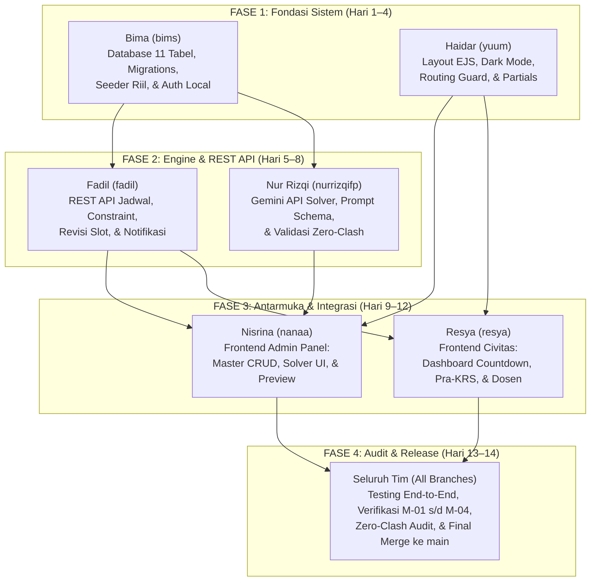

# Jadwalin — Master Job Distribution, Timeline & Branch Mapping
**Pemetaan Tugas 6 Developer & Urutan Pengerjaan Berdasarkan Dependensi Teknis**  
*Lead System Document v2.1 · PAW TI UMY 2026*

---

## 1. Pemetaan Branch Git

| No | Nama Developer | NIM | Git Branch | Peran Utama |
|---|---|---|---|---|
| 1 | **Bima Eka Setiawan** | 20240140089 | `bims` | 🗄 Database Sequelize, Seeder & Auth Local |
| 2 | **Haidar Yahya Mudhofar** | 20240140093 | `yuum` | 🎨 Design System, Routing & Layout Architecture |
| 3 | **Nur Rizqi Febriansyah Putra** | 20240140056 | `nurrizqifp` | 🤖 AI Integration & Solver Core (Gemini API) |
| 4 | **A. Muh. Fadil Asytar** | 20240140133 | `fadil` | 📅 Jadwal CRUD, Constraints & Notifikasi API |
| 5 | **Nisrina Hanifah Ramadhani** | 20240140075 | `nanaa` | 🎛 Frontend Admin Panel & Management UI |
| 6 | **Resya Glamoda Suhendri** | 20240140091 | `resya` | 🎓 Frontend Dosen, Mahasiswa & Wizard Pra-KRS |

---

## 2. Urutan Pengerjaan & Alur Dependensi (Siapa Dulu?)

Agar proses pengembangan tidak saling memblokir (*blocking dependency*), pengerjaan dibagi menjadi 4 fase berurutan:



---

## 3. Timeline & Roadmap Rinci

### 🟩 Fase 1: Fondasi Database, Auth & Shell Layout (Hari 1 – 4)
> **Fokus**: Menyiapkan struktur data riil dan kerangka halaman sebelum fitur bisnis dibangun.

| Developer | Target Selesai | Output Kunci | Dependensi Masuk |
|---|---|---|---|
| **Bima** (`bims`) | Hari 1–3 | 11 file migrations Sequelize, model asosiasi, dan seeder komprehensif (21 dosen, 77 MK, 12 ruang kuliah & lab, akun test admin/dosen/mahasiswa). | Schema ERD di `SYSTEM_DESIGN.md` |
| **Haidar** (`yuum`) | Hari 2–4 | Base layout EJS (`views/layouts/base.ejs`), navbar role-aware, sidebar collapsible admin, toggle dark mode persisted, dan partials. | Token di `DESIGN.md` & `ui-kit.html` |
| **Bima** (`bims`) | Hari 4 | Autentikasi lokal: endpoint `POST /api/auth/login`, JWT cookie/bearer middleware, dan RBAC (`admin`, `dosen`, `mahasiswa`). | Model User |

---

### 🟦 Fase 2: AI Solver Engine & Core REST API (Hari 5 – 8)
> **Fokus**: Logika penjadwalan cerdas dan endpoint controller backend.

| Developer | Target Selesai | Output Kunci | Dependensi Masuk |
|---|---|---|---|
| **Nur Rizqi** (`nurrizqifp`) | Hari 5–7 | Service Gemini API (`aiSolverService.js`), prompt builder terstruktur, JSON parser, dan kalkulasi metrik M-01 s/d M-04. | Seeder data Bima & `AI_GENERATOR_RULES.md` |
| **Fadil** (`fadil`) | Hari 5–7 | Endpoint jadwal: `GET /api/jadwal` (filter multi-aspek), `POST /api/jadwal/revisi` (edit slot cepat), dan `POST /api/jadwal/publish`. | Model Jadwal Bima |
| **Fadil** (`fadil`) | Hari 7–8 | Controller constraints (`HC-01 s/d HC-03`, preferensi dosen) dan dispatcher notifikasi (`services/notifikasiService.js`). | Model Constraint Bima |
| **Nur Rizqi** (`nurrizqifp`) | Hari 8 | Service validasi konflik lokal (`konflikService.js`) untuk deteksi bentrok pasca-generate AI. | Output AI & Aturan HC/SC |

---

### 🟨 Fase 3: Frontend Admin & Civitas Experience (Hari 9 – 12)
> **Fokus**: Penyelesaian antarmuka pengguna interaktif yang terhubung ke API backend.

| Developer | Target Selesai | Output Kunci | Dependensi Masuk |
|---|---|---|---|
| **Nisrina** (`nanaa`) | Hari 9–11 | Panel Admin Master Data: DataTable CRUD Dosen, Ruangan (termasuk Lab), Mata Kuliah, dan Mahasiswa (pencarian + modal). | API Master Fadil/Bima & Layout Haidar |
| **Nisrina** (`nanaa`) | Hari 11–12 | Panel Generator AI (progress bar live) & Kalender Mingguan Preview dengan tombol "Publikasikan" terproteksi zero-clash. | API Generate Rizqi & API Publish Fadil |
| **Resya** (`resya`) | Hari 9–10 | Dashboard Mahasiswa: Countdown sesi aktif real-time (`00:42:15 left`), kartu jadwal harian, dan banner notifikasi perubahan. | API Jadwal Fadil & Layout Haidar |
| **Resya** (`resya`) | Hari 11–12 | Wizard Pra-KRS 4-Step (Semester, Angkatan, NIM builder, Pemetaan Rekomendasi AI + tombol "Minta Variasi Lain") & Form Preferensi Dosen. | API Pra-KRS & API Preferensi Fadil |

---

### 🟧 Fase 4: Pengujian Terpadu, Zero-Clash Audit & Rilis (Hari 13 – 14)
> **Fokus**: Verifikasi kepatuhan PRD dan penggabungan kode.

| Pelaksana | Aktivitas Pengujian & Audit | Tolok Ukur Sukses |
|---|---|---|
| **Nur Rizqi & Fadil** | Uji beban generate AI dengan 21 dosen, 77 MK, 12 ruang/lab, dan 111 sesi. | Waktu generate < 15 menit (Target M-01) |
| **Nisrina & Bima** | Uji validasi Hard Constraints (HC-01, HC-02, HC-03) dan Lab Matching. | 0 bentrok jadwal final (M-02) & Lab 100% (M-03) |
| **Resya & Haidar** | Uji preferensi dosen dan keterbacaan mobile view (viewport 360px–414px). | Kepuasan dosen ≥ 85% (M-04) & Zero layout shift |
| **Seluruh Tim** | Pull Request review, resolusi merge conflict, dan merge final ke branch `main`. | Build lolos 100%, siap demo presentasi |

---

## 4. Rincian Deliverable Per Branch

### 1. Branch `bims` — Bima Eka Setiawan (20240140089)
- **Role**: Database Architect & Auth Specialist
- **Fokus File**:
  ```text
  models/User.js, Dosen.js, MataKuliah.js, Ruangan.js, Mahasiswa.js,
  models/PeriodeJadwal.js, JadwalSesi.js, JadwalDosen.js, ConstraintHard.js,
  migrations/*.js, seeders/*.js,
  middlewares/auth.js, middlewares/rbac.js,
  controllers/authController.js, routes/api/auth.js
  ```
- **Definition of Done (DoD)**:
  - Database PostgreSQL terhubung lancar via Sequelize ORM.
  - 11 tabel termigrasi tanpa error.
  - Seeder memuat 21 dosen riil, 77 mata kuliah, 12 ruangan (dengan tipe Lab), dan akun pengujian.
  - Autentikasi login/me berjalan dengan hash bcrypt dan token JWT.

---

### 2. Branch `yuum` — Haidar Yahya Mudhofar (20240140093)
- **Role**: UI System & Routing Architect
- **Fokus File**:
  ```text
  docs/DESIGN.md, docs/design/ui-kit.html,
  views/layouts/base.ejs, views/partials/*.ejs,
  public/css/main.css, public/js/app.js,
  routes/web.js, controllers/homeController.js
  ```
- **Definition of Done (DoD)**:
  - Standar Antislop diterapkan penuh (nol emoji, ikon Phosphor, tipografi resmi).
  - Mode Gelap / Terang (Light/Dark) berfungsi konsisten tanpa flicker.
  - Komponen dasar (navbar, sidebar admin, drawer notifikasi, modal dialog) siap dipakai oleh tim frontend.
  - Tampilan responsif mobile tervalidasi pada viewport 360px ke atas.

---

### 3. Branch `nurrizqifp` — Nur Rizqi Febriansyah Putra (20240140056)
- **Role**: AI Solver & Optimization Lead
- **Fokus File**:
  ```text
  services/aiSolverService.js, services/geminiClient.js,
  services/konflikService.js, services/metricsService.js,
  controllers/generateController.js, routes/api/generate.js
  ```
- **Definition of Done (DoD)**:
  - Integrasi Gemini API mengembalikan JSON jadwal sesuai skema `AI_GENERATOR_RULES.md`.
  - Waktu generate terukur < 15 menit (Target M-01).
  - Service konflik mampu mendeteksi tabrakan HC-01 (dosen), HC-02 (ruang), dan HC-03 (jeda ibadah).
  - Laporan konflik menyajikan deskripsi jelas dan saran slot alternatif.

---

### 4. Branch `fadil` — A. Muh. Fadil Asytar (20240140133)
- **Role**: Schedule & Notification Controller Lead
- **Fokus File**:
  ```text
  controllers/jadwalController.js, controllers/constraintController.js,
  controllers/notifikasiController.js, services/notifikasiService.js,
  routes/api/jadwal.js, routes/api/constraints.js, routes/api/notifikasi.js
  ```
- **Definition of Done (DoD)**:
  - Endpoint `GET /api/jadwal` mendukung filter kombinasi dosen, ruang, kelas, hari, semester.
  - Endpoint `POST /api/jadwal/revisi` memperbarui slot dan memicu re-check konflik.
  - Endpoint `POST /api/jadwal/publish` memvalidasi zero-clash sebelum mengubah status menjadi Terpublikasi.
  - Sistem notifikasi mencatat perubahan slot dan menyebarkannya ke drawer pengguna terkait.

---

### 5. Branch `nanaa` — Nisrina Hanifah Ramadhani (20240140075)
- **Role**: Admin Experience & Management Frontend Lead
- **Fokus File**:
  ```text
  views/admin/dashboard.ejs,
  views/admin/master/dosen.ejs, matkul.ejs, ruangan.ejs, mahasiswa.ejs,
  views/admin/constraints/hard.ejs, soft.ejs,
  views/admin/generate.ejs, views/admin/jadwal.ejs
  ```
- **Definition of Done (DoD)**:
  - DataTable master data mendukung pencarian dinamis, pagination, dan counter total.
  - Modal Create/Edit/Delete terhubung lancar ke REST API master.
  - Halaman generate menampilkan live progress bar dan laporan konflik jika ditemukan bentrok.
  - Grid preview jadwal memungkinkan revisi cepat via klik slot dan tombol Publikasikan terproteksi zero-clash.

---

### 6. Branch `resya` — Resya Glamoda Suhendri (20240140091)
- **Role**: Civitas Experience & Student Onboarding Frontend Lead
- **Fokus File**:
  ```text
  views/dosen/dashboard.ejs, jadwal.ejs, preferensi.ejs,
  views/mahasiswa/dashboard.ejs, jadwal.ejs, prakrs.ejs,
  views/auth/login.ejs
  ```
- **Definition of Done (DoD)**:
  - Dashboard mahasiswa menampilkan countdown sesi aktif real-time yang akurat.
  - Wizard Pra-KRS 4-Step berjalan fleksibel tiap semester dengan tombol "Minta Variasi Lain".
  - Form preferensi dosen mencatat hari off riset dan langsung tersinkronisasi ke sistem.
  - Tampilan jadwal hybrid (Grid Mingguan & Agenda Harian) berjalan mulus di browser smartphone.
